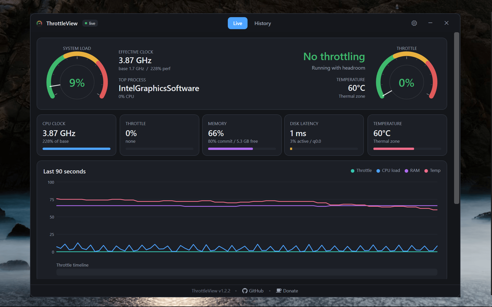
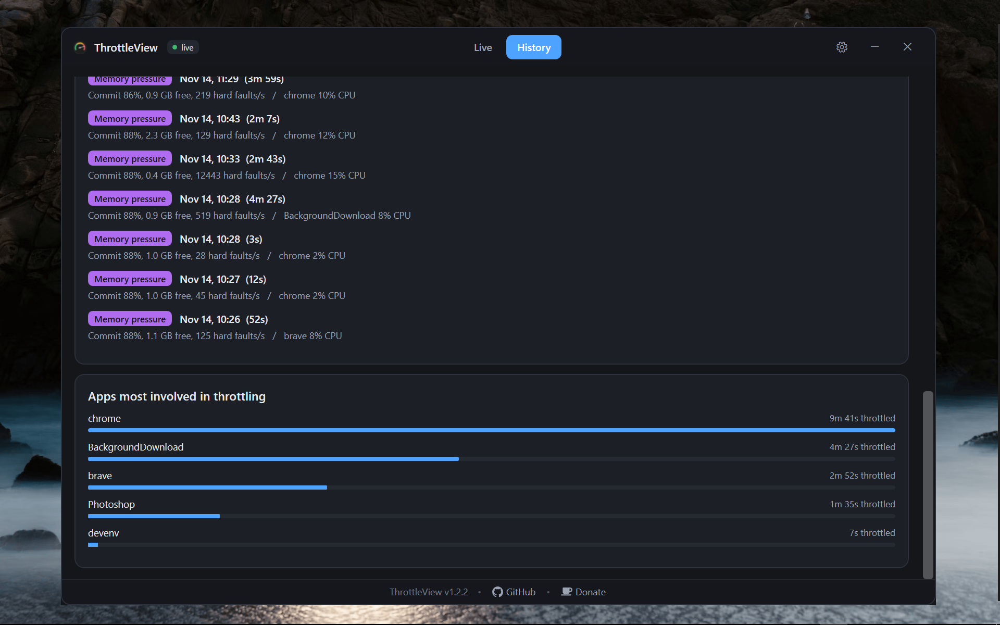
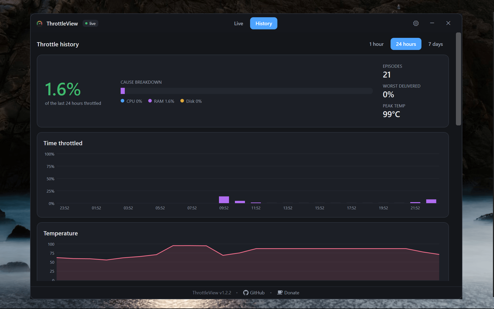

# ThrottleView


ThrottleView is a system-tray throttle monitor for Windows. It shows when your PC is being throttled, how badly, when, and why. It reads the processor clock against base from the CPU's hardware counter, separates heat from a power limit using temperature, and names the relevant apps. Everything runs locally as a single tray app with no administrator rights and no runtime to install.



## Summary

ThrottleView includes features to help you know if you are hitting throttling by:

- **Measured from hardware**: the delivered clock as a percentage of base, read from the CPU's `% Processor Performance` counter
- **Cause attribution**: every second is labeled CPU thermal, CPU power limit, CPU at capacity, memory pressure, or disk bottleneck
- **Two gauges**: CPU load and throttle level side by side, each with green, amber, and red zones
- **Temperature history**: read from the Windows thermal zones, with an optional sensor library for accurate CPU readings
- **Per-app blame**: each throttle episode includes the app with the highest CPU share for most of its duration
- **History that lasts**: 1 hour, 24 hours, and 7 days, with percent of time throttled, a cause breakdown, and an episode log
- **A dark dashboard**: two dial gauges, a 90-second graph, a throttle timeline, and the top processes
- **Local and lightweight**: one sample per second, no admin rights, and no network requests

## Features

### Delivered clock

ThrottleView reads the delivered clock as a percentage of the rated base from the `Processor Information \ % Processor Performance` counter. Above 100 is turbo and below 100 is under base. A clock below base while the CPU is busy is a thermal or power throttle, and a low clock at idle is power saving.

### Cause attribution

Each second is classified into one primary cause with a severity from 0 to 100:

- **CPU thermal throttle**: busy, clock below base, and the package is hot
- **CPU power limit**: busy and clock below base without a hot package, or with no temperature reading. PL1, PL2, and EDP limits are reported as this cause
- **CPU at capacity**: all cores near 100% busy. The limit is total compute
- **Memory pressure**: commit high or free memory low. Its severity is raised by hard page faults to disk
- **Disk bottleneck**: high transfer latency while the disk is busy or its queue is deep

A clock below base is counted only while CPU load is at or above the busy threshold. Idle downclocking is never reported as throttling.



### Temperature

A true CPU core temperature is stored in model-specific registers. Reading them needs a kernel driver, and a kernel driver needs administrator rights. ThrottleView tries three sources in order:

- **Sensor library**: accurate CPU temperatures from `LibreHardwareMonitorLib.dll`, loaded from next to the exe or from a `LibreHardwareMonitor` folder beside it. Its driver is loaded only when ThrottleView runs elevated. Relaunch with **Restart as administrator** in the tray menu for full readings
- **Thermal Zone Information counter**: a Windows performance counter that needs no admin rights and has readings on many laptops where WMI has none. A zone can be the package or the motherboard, and its reading can be below the die temperature
- **WMI `MSAcpi_ThermalZoneTemperature`**: the older built-in path, often admin-gated and frequently empty on laptops

With no usable reading from any of them, temperature is shown as "n/a" and a clock drop is reported as a power limit.

To enable the sensor library, download a release from [LibreHardwareMonitor releases](https://github.com/LibreHardwareMonitor/LibreHardwareMonitor/releases) and either extract it into a folder named `LibreHardwareMonitor` next to `ThrottleView.exe` or place `LibreHardwareMonitorLib.dll` and its dependency DLLs next to the exe. Then use the tray's **Restart as administrator**.

### Top processes

CPU share per process is sampled every 3 seconds and grouped by name, and a browser's worker processes are counted as one app. The Live view shows the top 6 with CPU share and memory, and each throttle episode includes the app with the highest CPU share for most of its duration.

### Live view

The Live tab, from top to bottom:

- Two dial gauges, CPU load on the left and throttle level on the right
- Between the gauges, the effective clock against base, the top process, the current cause with its detail line, and the temperature with its sensor source
- Metric cards for CPU clock, throttle, memory, disk latency, and temperature
- A 90-second graph of throttle, CPU load, RAM, and temperature, with a throttle timeline colored by cause
- The top processes with CPU share and memory

### History view

The History tab shows the last 1 hour, 24 hours, or 7 days: the percent of time throttled, a cause breakdown, the episode count, the worst delivered performance, the peak temperature, a stacked bar chart per time bucket, a temperature trend, the recent throttle episodes, and the apps most involved. History is stored as one compact record per minute.



### Tray, settings, and links

- The tray tooltip shows the current state, delivered performance, and effective clock
- Clicking or double-clicking the tray icon opens the window
- The tray menu has Open ThrottleView, Start with Windows, Restart as administrator, Reset history, and Exit
- Closing the window leaves ThrottleView recording in the tray
- Settings has start-with-Windows and the throttle thresholds
- The window footer shows the running version, with GitHub and Donate links

## Requirements

- **Windows 10 or Windows 11**, 64-bit
- **.NET Framework 4.8** runtime (preinstalled on current Windows)
- To build from source: **Visual Studio 2019/2022** with the .NET Framework 4.8 targeting pack
- To build the installer: **[Inno Setup](https://jrsoftware.org/isinfo.php)** 6.1+
- Optional, for accurate temperatures: a **LibreHardwareMonitor** release

## Installation

### Option A: Run a release build

1. Download the latest `ThrottleViewSetup-<version>-release.exe` from the Releases page (or build it yourself below)
2. Run the installer. It installs per-user with no administrator rights, adds a startup entry that launches into the tray, and starts ThrottleView
3. ThrottleView opens its window and records history from the tray after the window is closed

### Option B: Build from source

```bash
git clone https://github.com/lso2/ThrottleView.git
```

**Build the app**

1. Open `ThrottleView.sln` in Visual Studio
2. Select the **Release | x64** configuration (x64 only)
3. Build the solution. The executable is produced at `ThrottleView\bin\x64\Release\ThrottleView.exe`
4. Run `ThrottleView.exe`

**Build the installer (optional)**

1. Build the app first. The installer reads `ThrottleView.exe` and its version from the build output
2. Open `Installer.iss` in Inno Setup and press **Compile**
3. `ThrottleViewSetup-<version>-release.exe` is written to the `Output` folder one level above the repository folder

> The installer uses the `Release\x64` output when it exists and the `Debug\x64` output otherwise.

**Accurate temperatures (optional)**

The installer bundles `LibreHardwareMonitorLib.dll` when it is next to the built exe at compile time. A LibreHardwareMonitor release can also be extracted into a `LibreHardwareMonitor` folder inside the install folder. The library's driver is loaded only when ThrottleView runs elevated. Without the library, ThrottleView reads the Windows thermal zones.

## Usage

### Reading the gauges

- The left gauge is CPU load, from idle to fully busy
- The right gauge is the throttle level, where 0% means nothing is holding the machine back
- Each dial has green, amber, and red zones, and the needle shows the current value

### The current cause

- The state line shows the cause, for example "CPU power limit"
- The detail line under it has the readings, for example "1.20 GHz, 38% below base, power or current limit"
- With nothing throttling, the state line shows "No throttling"

### History

- Pick **1 hour**, **24 hours**, or **7 days**
- The summary shows the percent of time throttled, the split between CPU, RAM, and disk, the episode count, the worst delivered performance, and the peak temperature
- The bar chart shows when throttling clustered
- The episode list shows each episode's cause, start time, duration, the readings that triggered it, and the app most responsible

### Settings

- Open Settings from the gear in the title bar
- Toggle start-with-Windows and adjust the throttle thresholds
- Threshold changes take effect on the next sample, with no restart

## Settings and data

All data is stored locally under your user profile:

```
%APPDATA%\ThrottleView\
├── settings.json            # Preferences and every analyzer threshold
├── history\
│   ├── rollups.bin          # One compact record per minute (24h and 7d views)
│   └── episodes.jsonl       # One JSON line per throttle episode
└── debug.log                # Diagnostic log (never the Windows Event Log)
```

Reset history from the tray menu to clear the `history` folder while keeping your settings.

### Privacy

- **No cloud sync**: everything stays on your computer
- **No accounts**: no login or registration
- **No telemetry**: ThrottleView makes no external network requests
- **Readable formats**: a JSON settings file and a JSON-lines episode log you can open and back up anywhere

### settings.json format

```json
{
  "startWithWindows": true,
  "probeEnabled": true,
  "probeBaselineOpsPerMs": 0,
  "cpuBusyPct": 50,
  "clockThrottleBelowPct": 92,
  "cpuSaturatedPct": 93,
  "deliveredThrottleBelowPct": 90,
  "commitHighPct": 88,
  "availLowMB": 1024,
  "pagesInputHigh": 12,
  "diskLatencyHighMs": 25,
  "diskBusyPct": 80,
  "diskQueueHigh": 2.0,
  "tempHotC": 90,
  "liveSeconds": 3600,
  "rollupDays": 90,
  "windowWidth": 1120,
  "windowHeight": 740
}
```

## Compatibility

| OS | Supported | Notes |
|----|-----------|-------|
| Windows 11 | Yes | Full support |
| Windows 10 (incl. LTSC) | Yes | Developed and tested here |
| Windows 8.1 | Untested | Some performance counters and WMI classes differ |
| Windows 7 | Untested | Counter availability differs |
| macOS / Linux | No | Windows-only (WPF, performance counters, WMI) |

## Troubleshooting

### Temperature shows "n/a"

Windows often exposes no usable CPU temperature to a standard user, and the WMI thermal zone is empty on many laptops. Add the sensor library (see Temperature above) and use **Restart as administrator** for accurate CPU readings. Throttle detection works without temperature, and temperature is used only to tell heat from a power limit.

### It says "power limit" but I think it is heat

With no temperature reading, ThrottleView reports a clock drop as a power limit and adds "temp n/a" to the detail line. Add the sensor library for an accurate heat-or-power call.

### Build errors about C# syntax

The project uses the C# 7.3 language version that is the default for .NET Framework 4.8. Build with the .NET Framework 4.8 toolchain and the project's target framework unchanged.

## How it works

ThrottleView is a tray application built on WPF that runs as a normal user, reads only documented performance counters and WMI, and never installs a driver of its own. The core ideas:

- **`% Processor Performance`** from the `Processor Information` counter set is the delivered clock as a percentage of the base reported by its `Processor Frequency` counter
- **The analyzer** classifies each second from the clock counter, memory paging (`Pages Input/sec` and committed bytes), disk latency (`Avg. Disk sec/Transfer`), and temperature, into one cause with a severity, using thresholds you can edit
- **Temperature** comes from `LibreHardwareMonitorLib.dll` loaded by reflection when present, then the `Thermal Zone Information` counter, then `MSAcpi_ThermalZoneTemperature` over WMI, and is reported as "n/a" when none has a reading
- **Process blame** is computed from each process's growth in total processor time across the interval, grouped by name
- **History** is a second-resolution ring in memory for the live and one-hour views, minute rollups in a compact binary file for the longer windows, and one JSON line per episode
- **Settings** are serialized to JSON with `DataContractJsonSerializer`, and the diagnostic log is a plain file rotated at 1 MB, never the Windows Event Log

The full detection methodology, with sources, is in [docs/DETECTION.md](../docs/DETECTION.md).

## Project structure

```
ThrottleView/
├── ThrottleView.sln              # Visual Studio solution
├── Installer.iss                 # Inno Setup installer script
├── Install.ps1                   # No-admin PowerShell installer
├── CHANGELOG.md                  # Version history
├── LibreHardwareMonitor/         # Sensor library release, found by builds run from bin
├── screens/                      # Screenshots used in this README
└── ThrottleView/
    ├── ThrottleView.csproj       # Project (.NET Framework 4.8, x64, WPF)
    ├── app.manifest              # Per-monitor DPI, runs without elevation
    ├── throttleview.ico          # App and tray icon
    ├── App.xaml(.cs)             # Tray host, single instance, lifecycle
    ├── Models/
    │   ├── Sample.cs             # One second of measured state, and the cause enum
    │   └── ThrottleEpisode.cs    # A throttle episode and unix-time helpers
    ├── Services/
    │   ├── PerfMetrics.cs        # CPU, memory, and disk performance counters
    │   ├── TemperatureProvider.cs # Sensor library, thermal zone counter, and WMI
    │   ├── ProcessSampler.cs     # Top processes by CPU share
    │   ├── ThrottleAnalyzer.cs   # Per-second cause and severity
    │   ├── HistoryStore.cs       # Ring buffer, minute rollups, episode log
    │   ├── Monitor.cs            # The one-second sampling loop and episode state
    │   ├── SettingsStore.cs      # JSON settings and thresholds
    │   ├── Startup.cs            # Start-with-Windows HKCU toggle
    │   └── Log.cs                # Plain file logger
    ├── Themes/
    │   ├── Theme.Dark.xaml       # Dark palette
    │   └── Controls.xaml         # Control styles
    └── UI/
        ├── MainWindow.xaml(.cs)  # The dashboard shell and live update
        ├── HistoryView.xaml(.cs) # The history tab
        ├── SettingsWindow.xaml(.cs) # Thresholds and preferences
        ├── GaugeControl.cs       # The load and throttle dials
        ├── LiveGraph.cs          # The multi-series line graph
        ├── TimelineRibbon.cs     # The throttle timeline
        ├── StackBars.cs          # The history bar chart
        └── UiFormat.cs           # Shared colors and formatting
```

## Contributing

1. Fork the repository
2. Create a feature branch (`git checkout -b feature/your-feature`)
3. Make your changes (keep to documented counters and the existing C# 7.3 / .NET Framework 4.8 target)
4. Build and test on Windows 10 or 11
5. Commit your changes (`git commit -m 'Add your feature'`)
6. Push to the branch (`git push origin feature/your-feature`)
7. Open a Pull Request

## Author

PlexPixel ([plexpixel.com](https://plexpixel.com))

## License

Copyright (C) 2026 PlexPixel

ThrottleView is licensed under the GNU General Public License version 3 (GPL-3.0-only). The full text is in [LICENSE](LICENSE). Sections 15 and 16 of the license disclaim any warranty and limit liability.

---

**If ThrottleView is useful to you, please star the repository.**

## Buy me a coffee

Every coffee ☕ helps fuel more features and improvements!

[](https://plexpixel.com/donate)

**Funding priorities**

- Continued development
- New signals and views
- Faster fixes and updates
- Better documentation

---

*Made for people who want to know how their PC is running.*
